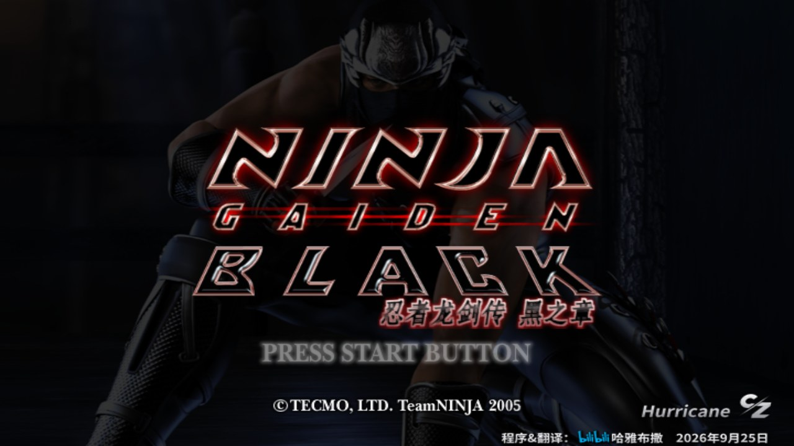
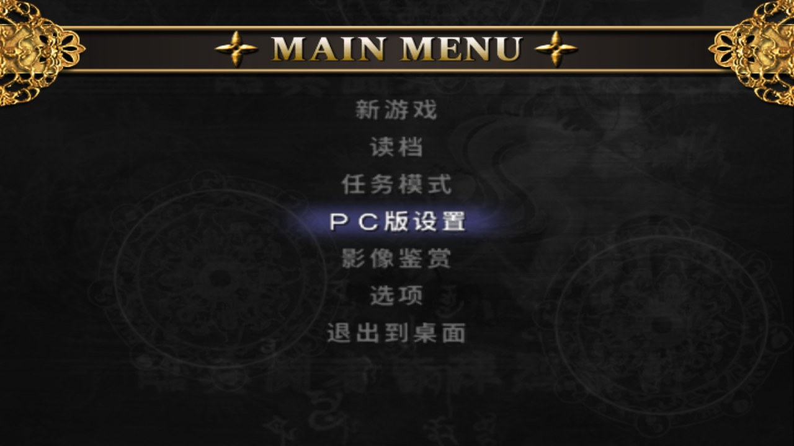
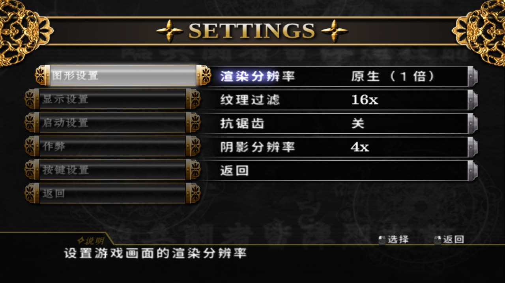
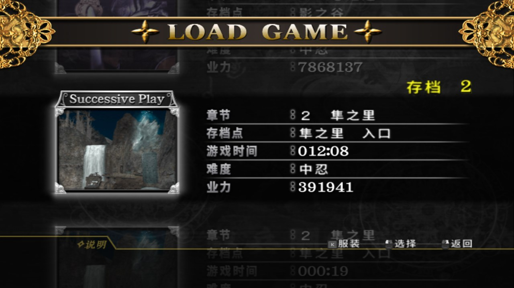
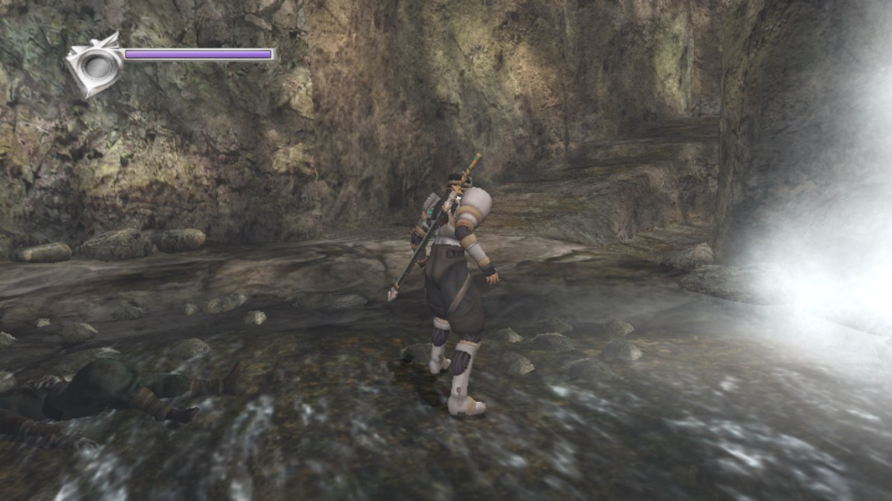

# Ninja Gaiden Black [Hurricane] PC — vb-zh-x2.1

[中文说明](README_zh.md) · [original ngbrecomp README](docs/README-ngbrecomp.md)

A Windows PC port of **NINJA GAIDEN BLACK [Hurricane] vb-zh-x2.1** — the Chinese/English fan patch by
哈雅布撒 (akirahayabusa) — built on [ngbrecomp](https://github.com/gamboozino/ngbrecomp) by gamboozino.
The game's code, with every change of the x2.1 patch in it, is statically recompiled from the patched
`default.xbe` into a native program: not an emulator.

## Screenshots



| | |
|---|---|
|  |  |
|  |  |

## Which disc

**Only `vb-zh-x2.1` is supported**: the retail USA disc (NTSC-U, title ID `5443000D`) with the
vb-zh-x2.1 patch applied. The program checks the patched `default.xbe` and refuses anything else:

| Disc | This build |
|---|---|
| vb-zh-x2.1 (Hurricane, Chinese/English) | **supported** |
| vb-jp-x2.1 (Hurricane, Japanese/English) | not yet — a separate branch is planned |
| va-zh-x2 (basic edition), older x / x2 versions | no |
| retail USA, unpatched | no — use upstream [ngbrecomp](https://github.com/gamboozino/ngbrecomp) |

No game data is included. You need your own copy of the game and the x2.1 patch.

## What you get

- Everything of vb-zh-x2.1: the Chinese text, the Intercept switch (Hurricane Pack / Black), Armlet of
  Tranquility, Kitetsu's health drain, a new round with all Golden Scarabs, the Talisman of Rebirth switch,
  costumes by trigger, the bow crosshair, the third-person camera option and the rest.
- ngbrecomp's PC features: high render resolutions, 16:9 / 16:10 / 21:9, keyboard and mouse with
  rebinding, MSAA, anisotropic filtering, steady frame pacing, Camera Sensitivity, Smoother Glow, and
  under Gameplay an NG2-style d-pad Quick Menu for weapons, Ninpo and items (off unless chosen); cheats
  including Infinite Items (healing items, the Talisman of Rebirth and the Jewel of the Demon Seal) and
  Infinite Projectiles; a HUD on/off switch and Positional Audio under Display & Audio; about 250 MB of video
  memory at the default settings (was over 3 GB before 0.9.27).
- The arcade Ninja Gaiden on the Han's bar cabinet and in the main menu (once unlocked), recompiled as programs
  of their own (`NinjaTrilogy.exe`, `NinjaTomoe.exe`; upstream #18): the game hands over to it and back. With the
  text in Chinese the game starts the Japanese build, as on the Xbox.
- The recomp's own menus (RECOMP SETTINGS, the pause menu's Settings tab, the F1 settings, the
  Exit page and dialogs) in Chinese while the game's text language is Asia (the x2.1 default).

Not included: the SFC Ninja Gaiden trilogy (`NinjaFCJ.xbe` / `NinjaFCU.xbe`), a separate program that is not
recompiled; its main-menu entry is not shown.

## Getting started (Windows)

1. Download the zip from [Releases](../../releases) and extract it anywhere.
2. Run `ngb-hurricane-zh-x2.1.exe` and choose your vb-zh-x2.1 disc image (`.iso`) or a folder with its
   extracted files. A disc image is installed once (about 6 GB) into `%LOCALAPPDATA%\ngb-hurricane-zh-x2.1`,
   or next to the program in portable mode (tick the box, or put a `portable.txt` beside the exe).

Needs Windows 10 or 11 (64-bit) and a GPU with Vulkan 1.3 drivers. Keys: F1 settings over the game,
F10 frame-rate counter, F11 or Alt+Enter fullscreen. Saves are separate from Xbox / xemu saves. Its folders (`ngb-hurricane-zh-x2.1` under `%LOCALAPPDATA%` and `%APPDATA%`) are its own, so it can sit beside ngbrecomp's retail install.

## Versions

Releases follow the ngbrecomp version they are based on (`hurricane-v0.9.9` = ngbrecomp 0.9.9); our own
updates on top of one add `-1`, `-2`, ... The window title shows it: `Ninja Gaiden Black Hurricane_x2.1_v0.9.28`.

## Changes from ngbrecomp

Branch `hurricane`, merged with upstream as it moves on:

- `src/install.c`: accepts the x2.1 `default.xbe` (its size and section hashes); setup messages in
  Chinese and English.
- The recompiler (`xboxrecomp/tools/recomp`): pushad / popad / pushfd / popfd, and three options for code
  patched into the XBE — `--flags-after-call` and `--flags-out` (hooks that hand their flags back to the
  caller) and `--ebp-to-callee` (hooks that read an FPO caller's ebp). Lists in `src/*.json`; tests in
  `xboxrecomp/tools/recomp/test_*.py`.
- Hand-written functions of ngbrecomp merged with the x2.1 changes in them (`src/pc_menu.c`,
  `src/menu_mouse.c`, `src/hurricane_hint.c`; scripts in `tools/hurricane/`), including the game functions
  upstream rewrote by hand: the cameras in `src/camera.c` (x2.1's camera-direction calls at 0x47A92 and
  0x4FA22) and the item count in `src/cheats.c` (x2.1's Talisman of Rebirth switch cleared at 0x1543B9).
- Chinese for the recomp's own text: `tools/hurricane/zh_text.tsv` → `src/hurricane_zh_data.c`
  (`tools/hurricane/make_zh.py`); the nine characters x2.1's glyph page lacks are added to its free cells
  at run time (`src/hurricane_zh.c`).
- Icon (a golden dragon, `tools/hurricane/make_icon.py`), window title with the version, per-monitor DPI
  awareness. The arcade programs go back to this one by its own name (`src/launch.c`). Upstream's Invert Camera, Invert First-Person X and Start in Third
  Person are left out: x2.1 has its own camera-direction option and starts every load in the third-person
  camera. Camera Sensitivity, which changes only the speed, is kept.

## Building from source (Windows)

Only the Windows build below is used and tested for this branch. Upstream's `tools/pipeline.sh` (Linux)
does not pass the Hurricane recompiler options and is not supported here. Upstream ngbrecomp also builds for
Linux and, experimentally, Apple Silicon macOS (see its README, [docs/README-ngbrecomp.md](docs/README-ngbrecomp.md));
neither is supported for this branch.

Requirements: llvm-mingw (UCRT, x86_64 Windows host), the MSYS2 CLANG64 packages in
`packaging/windows/deps.txt` unpacked into `<deps>/sysroot/clang64`, CMake, Ninja, Git Bash, and a Python
with `capstone`. Then, from Git Bash:

```sh
xboxrecomp/third_party/fetch.sh                          # once: Vulkan headers, volk, VMA and the like
NGB_PY=/path/to/python.exe tools/pipeline_win.sh /path/to/x2.1/default.xbe   # lift to C (a few minutes)
NGB_PY=/path/to/python.exe tools/pipeline_trilogy_win.sh /path/to/x2.1/NinjaTrilogy.xbe        # the arcade
NGB_PY=/path/to/python.exe tools/pipeline_trilogy_win.sh /path/to/x2.1/NinjaTomoe.xbe tomoe    # its Japanese build
cmake -S . -B build/x21 -G Ninja -DCMAKE_BUILD_TYPE=Release \
      -DCMAKE_TOOLCHAIN_FILE=cmake/toolchains/windows-x64-llvm-mingw-native.cmake \
      -DNGB_WIN_DEPS=<deps: holds llvm-mingw-*-ucrt-x86_64 and sysroot/clang64>
ninja -C build/x21 ninja_gaiden_black
```

`default.xbe` is the one extracted from your vb-zh-x2.1 disc image. The generated Chinese data
(`src/hurricane_zh_data.c`, `assets/fonts/NGBHanzi-Bold.ttf`) is committed; regenerating it needs the
localization project's charmap and glyph renderer.

## Credits and license

- PC port of the x2.1 patch: 哈雅布撒 / akirahayabusa (bilibili; QQ 2682557218).
- [ngbrecomp](https://github.com/gamboozino/ngbrecomp) by gamboozino; [xboxrecomp](https://github.com/sp00nznet/xboxrecomp)
  by sp00nznet. See [THIRD_PARTY.md](THIRD_PARTY.md) and `licenses/` in the release.
- Chinese font: a subset of Source Han Sans CN Bold (SIL OFL 1.1), renamed NGB Hanzi
  (`assets/fonts/OFL-NGBHanzi.txt`). The menu art words are pictures drawn with 鼎猎宋刻体; the font
  itself is not included.
- GPL-3.0-or-later, as ngbrecomp since 0.9.25 ([LICENSE](LICENSE)).

A non-commercial fan project for players who own the game. NINJA GAIDEN © KOEI TECMO GAMES / Team NINJA.
